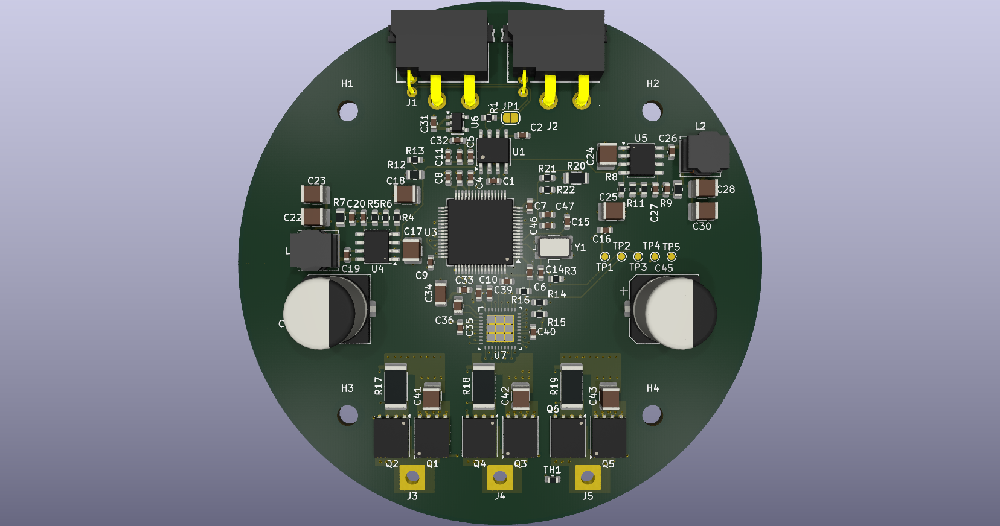
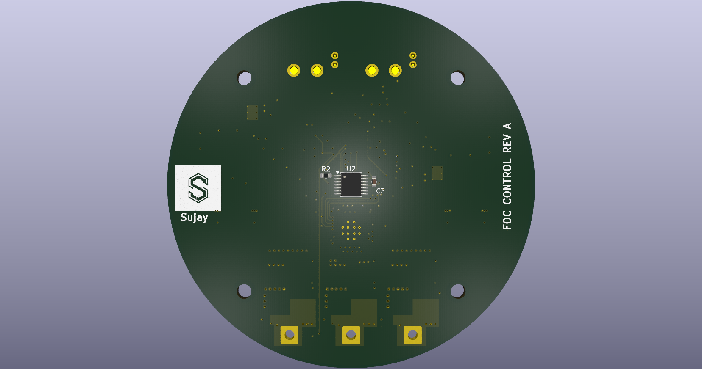
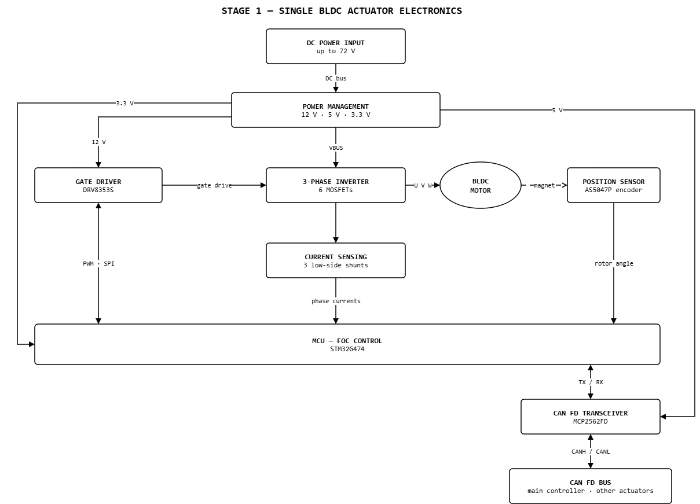
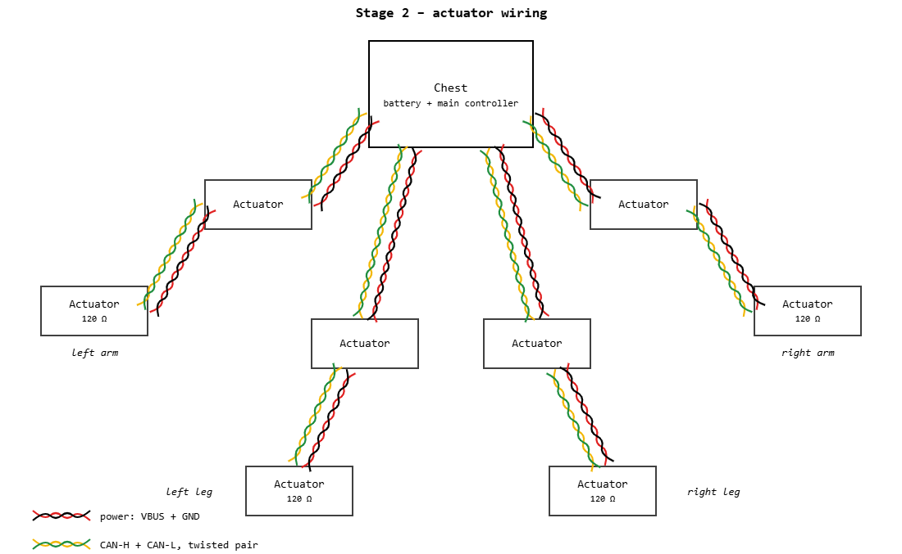

# FOC CONTROL REV A

BLDC field-oriented-control board for a humanoid robot actuator. KiCad 10, Ø80 mm, 8 layers, 1.6 mm.

| Top | Bottom |
|---|---|
|  |  |

## Main parts

| Function | Part |
|---|---|
| MCU | STM32G474RET3 |
| Gate driver | DRV8353S |
| MOSFETs | 6 × BSC040N10NS5 (100 V, 4 mΩ) |
| Current sensing | 3 × 1 mΩ low-side shunts |
| Position | AS5047P magnetic encoder (bottom side) |
| CAN FD | MCP2562FD, 2 × XT30PW 2+2 (power + CAN) |
| Supplies | 2 × LM5164 (12 V, 5 V), AP2112K (3.3 V) |

## Stage 1 – single actuator

## Stage 2 – multiple actuators

- One cable per link: VBUS + GND (16 AWG) and CAN-H / CAN-L as a twisted pair.
- Two XT30 2+2 connectors per board (IN, OUT), 15 A continuous.
- 120 Ω termination only at the two ends of each bus (JP1 on the last actuator).

## Stackup

| Layer | Use |
|---|---|
| F.Cu, 2 oz | Components, power pours |
| In1 | GND |
| In2 | Signals |
| In3 | VBUS |
| In4 | GND |
| In5 | Signals |
| In6 | GND |
| B.Cu, 2 oz | Phase pours, encoder |

Inner layers are 1 oz. Power runs on the 2 oz outer layers; every signal layer sits next to a plane.

## JLCPCB rules

| Rule | JLCPCB minimum (2 oz) | This board |
|---|---|---|
| Track / gap | 0.15 / 0.15 mm | 0.2 / 0.15 mm (0.15 mm only at fine-pitch pins) |
| Via diameter / hole | 0.25 / 0.15 mm | 0.45 / 0.2 mm |
| Copper to board edge | 0.2 mm | 0.5 mm |

## Trace widths

| Net class | Width | Gap |
|---|---|---|
| Signals | 0.2 mm | 0.15 mm |
| Gate drive | 0.3 mm | 0.15 mm |
| High voltage (VBUS, phases) | 0.5 mm, power in pours | 0.2 mm |
| CAN pair | 0.2 mm | 0.2 mm between the pair |

## Files

- Open `foc-control.kicad_pro` in KiCad 10. Project libraries are in `libs/`.
- BOM: `bom/foc-control.csv`.
